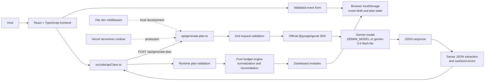

# Gatherly AI

> Turn celebration ideas into an executable event plan with Gemini-powered planning and deterministic budget calculations.

[](https://react.dev/)
[](https://www.typescriptlang.org/)
[](https://vite.dev/)
[](https://tailwindcss.com/)
[](https://ai.google.dev/)
[](https://vercel.com/)

**Live demo:** _Add the deployed Vercel URL after deployment._<br />
**Repository:** [github.com/VaibhavAran/Promptwar_Challlenge_5](https://github.com/VaibhavAran/Promptwar_Challlenge_5)

Gatherly AI is a React and TypeScript celebration planner for turning event details into a structured, practical planning workspace. A host provides the event type, date, city, guest count, budget, dietary preferences, theme, and special requirements; Gatherly then generates a tailored event concept, timeline, checklist, vendor guidance, risks, and budget allocation.

This project was built for PromptWars Virtual Challenge 5: **Celebration & Event Planner**.

## Problem Statement

Planning a celebration requires more than a theme idea. Hosts must coordinate a budget, vendors, guest needs, venue logistics, decoration, timing, and contingency plans. These details are often scattered across notes and spreadsheets, making it difficult to see what must happen next or whether the budget still reconciles.

Gatherly AI addresses that problem with a guided event form and a single planning workspace. Gemini provides personalized planning recommendations, while application code validates the result and performs the financial arithmetic deterministically. The result is a practical starting plan that is easy to inspect, edit, regenerate by section, and continue using in the browser.

## Project Overview

Gatherly AI is intended for hosts, families, community organizers, and event planners preparing:

- Weddings and receptions
- Milestone birthdays
- Anniversaries
- Community events and galas
- Intimate dinner parties
- Corporate and networking events

The workflow is:

1. Open the landing page and start a new event.
2. Enter and validate the celebration details.
3. Save the event draft to the workspace.
4. Generate a full event plan with Gemini.
5. Review the concept, budget, timeline, and checklist modules.
6. Edit checklist tasks, mark work complete, filter tasks, or export the checklist text.
7. Regenerate only the concept, budget, timeline, checklist, or vendor section when a focused revision is needed.
8. Continue from the same browser through local persistence.

## Features

### Guided event creation

The planner form collects and validates:

- Event name and supported event category
- Future event date
- City or region
- Guest count from 1 to 100,000
- Budget and supported currency (`USD`, `EUR`, `GBP`, `CAD`, `AUD`, `INR`)
- Dietary preferences including vegetarian, vegan, halal, kosher, gluten-free, and nut-free
- Theme or aesthetic direction
- Accessibility, permit, music, and other special requirements

The form includes sample data, reset, inline validation, and a workspace save action.

### Gemini-generated event concept

The concept module presents a personalized summary, theme ideas, decoration concepts, recommended activities, catering highlights, ambiance, practical tips, risks, and vendor categories. Content is tailored from the submitted event details and is clearly presented as planning guidance.

### Budget allocation and calculation

Gemini suggests percentage allocations and category descriptions. Gatherly's application code then:

- Normalizes the percentages to 100%.
- Rounds percentage values to whole numbers.
- Distributes percentage rounding drift.
- Calculates currency amounts from the host's fixed budget.
- Reconciles the final line-item total to the exact budget.
- Calculates a rounded per-guest cost.
- Displays an overflow warning when one category exceeds half of the budget.

The interface labels the values as illustrative planning guidelines rather than verified prices or vendor quotations.

### Personalized timeline

The timeline module separates:

- Preparation milestones before the event
- Final-week countdown tasks
- Concise hour-by-hour day-of entries

Each entry includes a time, title, responsible role, description, and criticality marker.

### Actionable checklist

The checklist module supports:

- AI-generated tasks across Vendor, Logistics, Guests, Decor, and Safety
- Adding custom tasks
- Marking tasks complete or incomplete
- Deleting tasks
- Filtering by status, category, or user-added tasks
- Copying the checklist text to the clipboard
- Preserving user tasks and completion state through section regeneration
- Persisting checklist work per event in the browser

### Section regeneration

After a full plan exists, the host can regenerate only one supported section: concept, budget, timeline, checklist, or vendors. The client merges the returned section into the existing plan and preserves unrelated plan data and checklist completion state.

### Validation and failure handling

The server validates incoming requests with Zod. The client sanitizes and shapes the generated payload before using it. The interface handles loading, success, empty, timeout, rate-limit, missing-key, malformed-output, and generic AI failure states with retry actions where appropriate.

### Responsive interface

The UI uses Tailwind responsive utilities for stacked mobile layouts, horizontal workspace tab scrolling, responsive grids, compact navigation, and desktop dashboard layouts.

## Screenshots and Demo

Screenshots are intentionally listed as placeholders until final captures are added. No screenshots are fabricated by this repository.

| Screen | Suggested file | Status |
| --- | --- | --- |
| Landing page | `docs/screenshots/landing-page.png` | Capture before submission |
| Event creation form | `docs/screenshots/event-creation-form.png` | Capture before submission |
| AI-generated event plan | `docs/screenshots/ai-event-plan.png` | Capture after successful generation |
| Budget breakdown | `docs/screenshots/budget-breakdown.png` | Capture after successful generation |
| Timeline | `docs/screenshots/timeline.png` | Capture after successful generation |
| Task checklist | `docs/screenshots/task-checklist.png` | Capture after successful generation |

**Demo video:** _Add a link to the final demo video._<br />
**Live application:** _Add the deployed Vercel URL._

## Technology Stack

| Technology | Role in this project |
| --- | --- |
| React 19 | Component-based frontend UI and application state composition |
| TypeScript 5.9 | Static typing for forms, plans, API contracts, and utilities |
| Vite 8 | Frontend development server and production bundler |
| Tailwind CSS 3 | Responsive layout and visual styling utilities |
| Lucide React | Interface icons used throughout the planner and dashboard |
| Google Gemini API | Generates event concepts, recommendations, timelines, checklists, risks, and percentage budget suggestions |
| `@google/genai` | Official Google GenAI SDK used only by the server endpoint |
| Zod 4 | Runtime validation for incoming requests and structured plan data |
| Vercel Functions | Production hosting for `/api/generate-plan` |
| Vitest 5 | Unit and integration-style tests for API behavior, validation, budgeting, and regeneration |
| ESLint 10 | Static code-quality checks |

## System Architecture



### Request flow

1. The user enters an event draft in React.
2. The form performs client-side validation and saves the draft to browser storage.
3. `src/utils/apiClient.ts` sends a relative `POST` request to `/api/generate-plan`.
4. The serverless handler validates the request and reads the server-side Gemini environment variables.
5. The handler builds either a full-plan or section-regeneration prompt and calls Gemini through `@google/genai`.
6. The handler requests JSON output, extracts a parseable JSON object, and maps failures to sanitized API responses.
7. The client validates and shapes the response, computes the budget in application code, and renders the dashboard.
8. Subsequent section regeneration merges only the requested section.

## How GenAI Is Used

### Configured model

The configured model is read from `GEMINI_MODEL`. The application default is:

```text
gemini-3.5-flash-lite
```

This can be overridden in the server environment without exposing the model configuration to the browser.

### Input sent to Gemini

The server prompt includes the validated event name, category, date, location, guest count, fixed budget, currency, dietary preferences, theme, and special requirements. The prompt asks Gemini for either a complete plan or one specific regenerable section.

### Generated planning content

Gemini supplies qualitative and structured planning content for:

- Event narrative and atmosphere
- Theme, decoration, activity, and catering ideas
- Percentage-based budget categories
- Preparation, week-of, and day-of timeline entries
- Checklist tasks and priorities
- Vendor service categories, lead times, and local planning tips
- Practical tips and event risks with mitigations

### Validation and deterministic logic

The server validates request fields with Zod and safely extracts JSON from the model response. The client validates and sanitizes the returned sections before rendering them. Budget arithmetic is deliberately not delegated to Gemini: the model suggests percentages, while `src/utils/budgetEngine.ts` performs normalization, rounding, reconciliation, per-guest calculation, and overflow detection.

This division keeps the creative planning flexible while making the numerical output predictable and testable.

### Security boundary

The frontend never imports `@google/genai` and never reads `GEMINI_API_KEY`. The key is read from `process.env` inside the serverless endpoint. Never prefix the key with `VITE_`, because Vite-prefixed variables are intended for client exposure.

## Installation and Local Setup

### Prerequisites

- Node.js 20 or newer
- npm
- A Gemini API key from [Google AI Studio](https://aistudio.google.com/)

### Windows PowerShell

```powershell
git clone https://github.com/VaibhavAran/Promptwar_Challlenge_5.git
Set-Location .\Promptwar_Challlenge_5
npm install
Copy-Item .env.example .env.local
notepad .env.local
npm run dev
```

Open `http://localhost:5173` after the development server starts. The Vite configuration includes local middleware for `/api/generate-plan`, so a separate API server is not required.

If a Windows execution policy blocks `npm.ps1`, use the equivalent `npm.cmd` form, for example `npm.cmd run dev`.

### Optional Vercel local runtime

After installing dependencies, the local Vercel CLI can also be used:

```powershell
npx vercel dev
```

### Verification commands

```powershell
npm run lint
npm test
npm run build
```

The verified test suite currently contains **31 tests** across API handling, budget calculations, runtime validation, and section regeneration/preservation.

## Environment Variables

Create `.env.local` for local development. Keep it out of Git.

```env
# Required on the server only. Never use a VITE_ prefix.
GEMINI_API_KEY=your-gemini-api-key-here

# Optional model override. The application default is the same value.
GEMINI_MODEL=gemini-3.5-flash-lite
```

| Variable | Required | Description |
| --- | --- | --- |
| `GEMINI_API_KEY` | Yes for generation | Server-side Google Gemini API key from Google AI Studio |
| `GEMINI_MODEL` | No | Gemini model name; defaults to `gemini-3.5-flash-lite` |

Never commit `.env.local`, paste the API key into frontend code, or rename it to `VITE_GEMINI_API_KEY`.

The committed [`.env.example`](.env.example) file contains placeholders only.

## Project Structure

```text
.
├── api/
│   └── generate-plan.ts              # Vercel-compatible Gemini serverless endpoint
├── public/
│   ├── favicon.svg                   # Application favicon
│   └── icons.svg                     # Public icon assets
├── src/
│   ├── App.tsx                       # View routing and draft persistence
│   ├── main.tsx                      # React entry point
│   ├── components/
│   │   ├── common/                   # Button, input, select, card, and badge primitives
│   │   ├── landing/                  # Landing page and event-type showcase
│   │   ├── layout/                   # Navbar and footer
│   │   ├── planner/                  # Event creation form
│   │   └── dashboard/                # Generation panel and AI planning modules
│   ├── hooks/
│   │   └── useEventPlan.ts           # Generation state and plan persistence
│   ├── types/
│   │   ├── event.ts                  # Event draft and form types
│   │   └── generatedPlan.ts           # Plan types, Zod schemas, and API types
│   ├── utils/
│   │   ├── apiClient.ts              # Relative API client and response assembly
│   │   ├── budgetEngine.ts           # Deterministic budget calculations
│   │   ├── formatters.ts             # Currency, date, and event labels
│   │   ├── planValidator.ts          # AI payload sanitization and shaping
│   │   └── validation.ts              # Event form validation
│   └── tests/                        # Vitest coverage for core behavior
├── .env.example                      # Safe environment template
├── .gitignore                        # Ignores secrets, dependencies, and build output
├── index.html                        # Vite HTML entry point
├── package.json                      # Scripts and dependencies
├── tailwind.config.js                # Tailwind theme configuration
├── tsconfig.json                     # TypeScript configuration
└── vite.config.ts                    # Vite config and local API middleware
```

## API Documentation

### `POST /api/generate-plan`

The endpoint accepts a JSON body for a full plan or a section regeneration.

#### Request body

```json
{
  "eventDraftId": "evt-example-123",
  "eventName": "Autumn Garden Dinner",
  "eventType": "dinner_party",
  "date": "2027-10-15",
  "city": "Chicago, IL",
  "guestCount": 24,
  "budget": 8500,
  "currency": "USD",
  "foodPreferences": ["vegetarian"],
  "theme": "Warm candlelit modernism",
  "specialRequirements": "Step-free access and a quiet seating area"
}
```

Supported `eventType` values are `birthday`, `wedding`, `anniversary`, `community`, `dinner_party`, and `corporate`. Supported currencies are `USD`, `EUR`, `GBP`, `CAD`, `AUD`, and `INR`. Add `section` with one of `concept`, `budget`, `timeline`, `checklist`, or `vendors` to request a focused regeneration.

#### Success response

```json
{
  "success": true,
  "raw": {
    "concept": {},
    "budgetSplits": [],
    "timeline": {},
    "checklist": [],
    "vendors": [],
    "practicalTips": [],
    "risks": []
  },
  "isSection": false
}
```

The `raw` payload is shaped by the client into the internal `GeneratedEventPlan` structure. For section regeneration, `isSection` is `true` and `section` identifies the requested section.

#### Validation and errors

| Status | Code | Meaning |
| ---: | --- | --- |
| `200` | — | JSON response returned successfully |
| `400` | `VALIDATION_ERROR` | Request body does not match the event contract |
| `405` | `UNKNOWN` | Request method is not `POST` |
| `429` | `RATE_LIMIT` | Gemini quota or rate limit was reached |
| `502` | `AI_ERROR` | Gemini returned an empty response or an unexpected service error |
| `502` | `PARSE_ERROR` | Gemini output could not be parsed as JSON |
| `503` | `MISSING_KEY` | `GEMINI_API_KEY` is not configured server-side |
| `504` | `TIMEOUT` | The Gemini request exceeded the server timeout |

Error responses include `success: false`, a user-safe `error` message, a `code`, and a `retryable` flag. Internal provider errors and API keys are not returned to the client.

## Budget Calculation Logic

Gemini returns category percentages and descriptions only. The exact monetary values are computed by `src/utils/budgetEngine.ts`:

1. Convert the requested budget and guest count to safe numeric values.
2. Sum the AI percentages.
3. Normalize each category to a total of 100%.
4. Round percentages to whole numbers.
5. Add any percentage rounding remainder to the largest category.
6. Calculate each category amount with `Math.round`.
7. Reconcile any currency rounding difference by applying the remaining difference to the first line item.
8. Calculate the rounded per-guest cost.
9. Add an overflow warning if one category exceeds 50% of the total.

If Gemini returns no usable budget splits, the engine uses a deterministic default allocation. Every displayed amount includes a disclaimer that it is an illustrative planning guideline, not a verified quote.

## Testing and Quality Assurance

The project uses Vitest for automated checks and ESLint for static analysis.

The test suite covers:

- API method, key, request-validation, success, parse-error, timeout, and rate-limit behavior
- JSON extraction from direct and fenced model responses
- Budget normalization, rounding, reconciliation, per-guest calculations, fallbacks, and overflow warnings
- Runtime sanitization of concept, timeline, checklist, vendor, risk, and request data
- Section regeneration and preservation of unrelated data and checklist completion state

Run the checks with:

```powershell
npm run lint
npm test
npm run build
```

The current verified suite contains **31 passing tests**.

## Deployment on Vercel

The repository is structured for Vercel's Vite frontend deployment with a root `api/` serverless function. No `vercel.json` is required for the current layout.

1. Push the repository to GitHub.
2. Import the repository into Vercel.
3. Keep the detected Vite framework and default build settings unless the project dashboard requires an override.
4. Add the following environment variables to the Production environment, and to Preview if preview deployments should generate plans:

   ```env
   GEMINI_API_KEY=<your-real-key>
   GEMINI_MODEL=gemini-3.5-flash-lite
   ```

5. Deploy the project.
6. Open the deployed frontend and submit a sample event.
7. Verify that `/api/generate-plan` returns a plan and that the dashboard renders concept, budget, timeline, and checklist sections.

The frontend uses the relative API path `/api/generate-plan`, so the same client code works locally and on the deployed domain.

## Limitations and Future Scope

### Current limitations

- Gatherly does not book vendors or make payments.
- Vendor entries are recommendations and planning categories, not confirmed providers.
- Vendor availability, pricing, and quotations are not verified in real time.
- Generation depends on Gemini availability, quota, network connectivity, and the configured API key.
- Drafts, generated plans, and checklist state are stored in the current browser's localStorage; there is no account system or cloud database.
- The application does not currently provide multi-user collaboration or authenticated workspaces.
- Generated event content should be reviewed by the host and adapted to the venue's real constraints.

### Possible future improvements

- Authenticated cloud workspaces and cross-device synchronization
- Vendor directory integrations with availability and quote requests
- Streaming generation progress
- Export to PDF, calendar, or project-management tools
- Collaboration, sharing, and role-based planning access
- Automated end-to-end browser testing in CI

## Challenge Information

- **Challenge:** PromptWars Virtual Challenge 5
- **Theme:** Celebration & Event Planner
- **Project:** Gatherly AI

## Acknowledgements

Gatherly AI uses and acknowledges the following open-source and platform technologies:

- [React](https://react.dev/)
- [TypeScript](https://www.typescriptlang.org/)
- [Vite](https://vite.dev/)
- [Tailwind CSS](https://tailwindcss.com/)
- [Lucide](https://lucide.dev/)
- [Zod](https://zod.dev/)
- [Google Gemini API](https://ai.google.dev/)
- [Vercel](https://vercel.com/)

## License

This repository currently has no explicit open-source license file. Unless a license is added by the project owner, the source should be treated as **all rights reserved** and should not be redistributed or reused beyond applicable challenge evaluation permissions.
